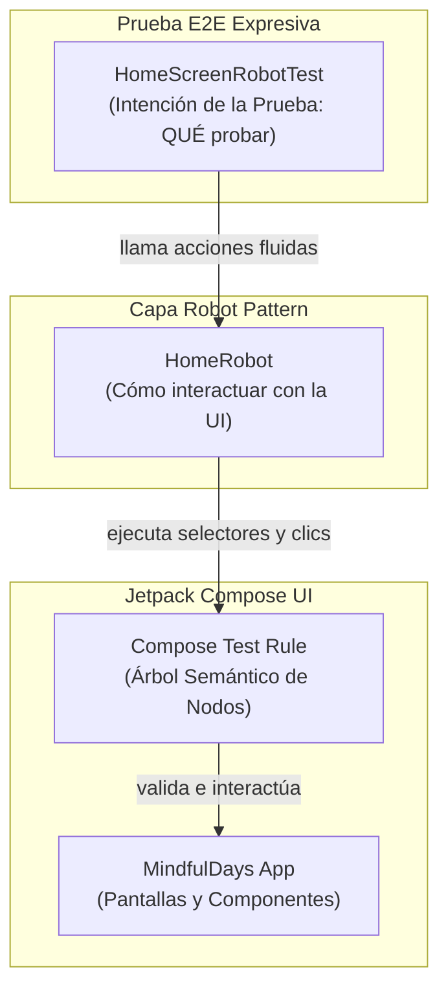

# 🧪 Módulo 4 — Calidad de Software, Pruebas Automatizadas con IA y Robot Pattern

En este último módulo del workshop, elevaremos la calidad de ingeniería de la aplicación **MindfulDays**. En lugar de enfocarnos únicamente en configuraciones de infraestructura de CI/CD, exploraremos en la práctica cómo la **Inteligencia Artificial generativa** acelera la creación de suites de pruebas robustas, cubriendo:
1. **Pruebas Unitarias**: Validación de la regla de negocio de las 9 actitudes de Jon Kabat-Zinn y rotación temporal.
2. **Pruebas de UI en Jetpack Compose**: Validación de estados de la interfaz declarativa y renderizado de componentes.
3. **Pruebas End-to-End (E2E) con Robot Pattern**: Arquitectura limpia para pruebas visuales que separa *qué* se está probando de *cómo* se manipula la interfaz, permitiendo que la IA genere pruebas expresivas y sostenibles.

---

## 🎯 4.1. ¿Por qué Probar con IA y el Rol del Robot Pattern?

Escribir pruebas de interfaz y de extremo a extremo (E2E) tradicionalmente requiere mucho esfuerzo: selectores frágiles, repetición de código para encontrar elementos en el árbol semántico y pruebas que se rompen fácilmente ante cualquier cambio mínimo de diseño.

Con herramientas de IA generativa (como Gemini en Android Studio o Claude):
- **La IA genera escenarios de prueba exhaustivos y casos límite (*edge cases*)** (ej: cambio de año bisiesto, textos largos, fallbacks de red).
- **El Robot Pattern simplifica la generación con IA**: al definir una clase "Robot" que encapsula los selectores de Compose Test Rule, le pedimos a la IA que genere únicamente la intención de alto nivel de la prueba (*"entra en Home, revisa la reflexión y haz clic en el temporizador"*), resultando en un código limpio, fluido y desacoplado.



---

## 🔬 4.2. Pruebas Unitarias de Regla de Negocio (`AttitudeRepositoryTest`)

La regla de negocio central de **MindfulDays** define que la actitud del día se calcula cíclicamente a partir del día del año:
$$\text{índice} = (\text{díaDelAño} - 1) \pmod 9$$

Garantizaremos la solidez de esta lógica creando el archivo en `app/src/test/java/dev/mindfuldays/app/data/repository/AttitudeRepositoryTest.kt`:

```kotlin
package dev.mindfuldays.app.data.repository

import org.junit.Assert.assertEquals
import org.junit.Assert.assertNotNull
import org.junit.Assert.assertTrue
import org.junit.Before
import org.junit.Test

class AttitudeRepositoryTest {

    private lateinit var repository: AttitudeRepository

    @Before
    fun setUp() {
        repository = AttitudeRepository()
    }

    @Test
    fun `garantizar que la lista contiene exactamente 9 actitudes de mindfulness`() {
        val attitudes = repository.attitudes
        assertEquals(9, attitudes.size)
    }

    @Test
    fun `garantizar que todas las actitudes poseen IDs unicos y recursos de string validos`() {
        val attitudes = repository.attitudes
        val ids = attitudes.map { it.id }.toSet()
        assertEquals(9, ids.size)

        attitudes.forEach { attitude ->
            assertTrue("El ID de recurso del nombre no debe ser cero", attitude.nameRes != 0)
            assertTrue("El ID de recurso de la descripción no debe ser cero", attitude.descriptionRes != 0)
            assertTrue("El nombre por defecto no debe estar vacío", attitude.name.isNotBlank())
        }
    }

    @Test
    fun `garantizar rotacion ciclica correcta de las 9 actitudes por dia del ano`() {
        // Día 1 (1 de Enero): Primera actitud (id = 1)
        assertEquals(1, repository.getTodayAttitude(dayOfYear = 1).id)

        // Día 9: Novena actitud (id = 9)
        assertEquals(9, repository.getTodayAttitude(dayOfYear = 9).id)

        // Día 10: Reinicia el ciclo en la primera actitud (id = 1)
        assertEquals(1, repository.getTodayAttitude(dayOfYear = 10).id)

        // Día 365 (año común): (365 - 1) % 9 = 364 % 9 = 4 -> índice 4 -> id = 5 ("Confianza")
        assertEquals(5, repository.getTodayAttitude(dayOfYear = 365).id)
    }

    @Test
    fun `garantizar que la llamada por defecto de hoy retorna una actitud valida`() {
        val today = repository.getTodayAttitude()
        assertNotNull(today)
        assertTrue(today.id in 1..9)
    }
}
```

### 🤖 Prompt para que Gemini genere Pruebas Unitarias
En Android Studio, abre el archivo `AttitudeRepository.kt` y envía el siguiente prompt al asistente:

```text
Actúa como un Ingeniero de QA Android senior.
Analiza la clase AttitudeRepository.kt adjunta.
Escribe una suite completa de pruebas unitarias con JUnit 4 evaluando:
1. Si la lista contiene exactamente 9 elementos únicos.
2. La regla de rotación temporal cíclica basada en el día del año (prueba el primer día, el 9º día, el reinicio en el 10º día y el último día del año).
3. Si todos los atributos obligatorios y referencias a recursos de strings (@StringRes) están completados.
Genera código Kotlin idiomático con nombres de métodos descriptivos entre acentos graves (backticks).
```

### ⚡ Ejecución de las Pruebas Unitarias
En la terminal de Android Studio, ejecuta:
```bash
./gradlew testDebugUnitTest
```
> El reporte visual en HTML con el resultado de las pruebas está disponible en `app/build/reports/tests/testDebugUnitTest/index.html`.

---

## 📱 4.3. Pruebas de Interfaz con Jetpack Compose

Con Jetpack Compose no utilizamos IDs de vistas XML. Compose utiliza un **Árbol Semántico** (*Semantics Tree*) para localizar nodos de texto, descripciones de accesibilidad y estados de los componentes.

Podemos probar el composable desacoplado `HomeScreenContent` verificando la representación de los datos y que las lambdas de evento se disparen correctamente al interactuar con los botones.

---

## 🤖 4.4. Pruebas End-to-End con el Robot Pattern

El **Robot Pattern** es un patrón ampliamente adoptado en el ecosistema Android que consiste en:
1. Crear una clase **Robot** responsable de aislar todos los comandos de la `ComposeContentTestRule` (encontrar nodos por texto, hacer clic en botones, verificar visibilidad).
2. Proporcionar un **DSL fluido** (`homeRobot { ... }`) donde la prueba se lee como una secuencia de acciones del usuario en lenguaje natural.

### 1. Creando `HomeRobot.kt`
Crea el archivo en `app/src/androidTest/java/dev/mindfuldays/app/robot/HomeRobot.kt`:

```kotlin
package dev.mindfuldays.app.robot

import androidx.compose.ui.test.assertIsDisplayed
import androidx.compose.ui.test.junit4.ComposeContentTestRule
import androidx.compose.ui.test.onNodeWithContentDescription
import androidx.compose.ui.test.onNodeWithText
import androidx.compose.ui.test.performClick

/**
 * Robot Pattern para HomeScreen.
 * Encapsula las interacciones y aserciones de la interfaz de usuario en Jetpack Compose,
 * haciendo las pruebas declarativas, legibles y fáciles de mantener.
 */
class HomeRobot(private val composeTestRule: ComposeContentTestRule) {

    fun assertTitleDisplayed(title: String) = apply {
        composeTestRule.onNodeWithText(title).assertIsDisplayed()
    }

    fun assertAttitudeName(name: String) = apply {
        composeTestRule.onNodeWithText(name).assertIsDisplayed()
    }

    fun assertReflectionText(reflection: String) = apply {
        composeTestRule.onNodeWithText(reflection).assertIsDisplayed()
    }

    fun clickGenerateReflection(buttonText: String) = apply {
        composeTestRule.onNodeWithText(buttonText).performClick()
    }

    fun clickSettingsButton(contentDescription: String) = apply {
        composeTestRule.onNodeWithContentDescription(contentDescription).performClick()
    }

    fun clickTimerButton(buttonText: String) = apply {
        composeTestRule.onNodeWithText(buttonText).performClick()
    }
}

/**
 * Función DSL para inicializar y ejecutar pasos con el HomeRobot.
 */
fun homeRobot(
    composeTestRule: ComposeContentTestRule,
    block: HomeRobot.() -> Unit
): HomeRobot = HomeRobot(composeTestRule).apply(block)
```

---

### 2. Creando la Prueba E2E Expresiva (`HomeScreenRobotTest.kt`)
Crea el archivo en `app/src/androidTest/java/dev/mindfuldays/app/HomeScreenRobotTest.kt`:

```kotlin
package dev.mindfuldays.app

import androidx.compose.ui.test.junit4.createComposeRule
import androidx.test.ext.junit.runners.AndroidJUnit4
import dev.mindfuldays.app.data.model.MindfulnessAttitude
import dev.mindfuldays.app.robot.homeRobot
import dev.mindfuldays.app.ui.home.HomeScreenContent
import dev.mindfuldays.app.ui.theme.MindfulDaysTheme
import org.junit.Assert.assertTrue
import org.junit.Rule
import org.junit.Test
import org.junit.runner.RunWith

@RunWith(AndroidJUnit4::class)
class HomeScreenRobotTest {

    @get:Rule
    val composeTestRule = createComposeRule()

    @Test
    fun homeScreen_muestraActitudYReflexion_yEjecutaAcciones() {
        var clickedAi = false
        var clickedTimer = false
        val attitude = MindfulnessAttitude(
            id = 3,
            name = "Aceptación",
            description = "Reconoce y acoge el momento presente exactamente como es.",
            nameRes = R.string.attitude_3_name,
            descriptionRes = R.string.attitude_3_desc
        )

        composeTestRule.setContent {
            MindfulDaysTheme {
                HomeScreenContent(
                    attitude = attitude,
                    aiReflection = "Reflexión de prueba para el workshop",
                    isLoadingAi = false,
                    onGenerateAiReflection = { clickedAi = true },
                    onNavigateToSettings = {},
                    onNavigateToTimer = { clickedTimer = true }
                )
            }
        }

        // Obtiene el contexto para recuperar cadenas internacionalizadas
        val context = androidx.test.platform.app.InstrumentationRegistry.getInstrumentation().targetContext

        // Ejecución expresiva y limpia con el Robot Pattern
        homeRobot(composeTestRule) {
            assertReflectionText("Reflexión de prueba para el workshop")
            clickGenerateReflection(context.getString(R.string.btn_new_reflection))
            clickTimerButton(context.getString(R.string.btn_start_timer))
        }

        // Valida que las acciones se hayan ejecutado
        assertTrue("El botón de IA debió haberse presionado", clickedAi)
        assertTrue("El botón de navegación al Temporizador debió haberse presionado", clickedTimer)
    }
}
```

> [!TIP]
> **Compatibilidad con Internacionalización (i18n) en Pruebas:**
> Al utilizar `context.getString(R.string.btn_new_reflection)` para obtener los textos de los botones, la prueba es compatible automáticamente con cualquier idioma configurado en el emulador (sea español, inglés o portugués), evitando fallas por cadenas de texto fijas (*hardcoded*).

---

### 🤖 4.5. Prompt para Solicitar a la IA la Creación de Nuevos Robots
Al demostrar esto en el workshop, enseña a los asistentes cómo pedirle a la IA que cree nuevos Robots para otras pantallas (como `TimerScreen` o `SettingsScreen`):

```text
Eres un especialista en pruebas de UI de Android con Jetpack Compose.
Analiza la pantalla Composable adjunta (TimerScreen.kt).
1. Crea una clase 'TimerRobot' utilizando el Robot Pattern con ComposeContentTestRule, que contenga:
   - Métodos de aserción: assertTimerTextIsDisplayed(time: String), assertStatusIsDisplayed(status: String).
   - Métodos de acción: clickPlayPause(), clickReset().
   - Una función DSL 'timerRobot(rule) { ... }' que retorne el Robot.
2. A continuación, escribe una prueba instrumentada con JUnit 4 usando TimerRobot simulando:
   - Iniciar con el temporizador pausado en "10:00".
   - Hacer clic en el botón Play/Pause y verificar la transición.
   - Hacer clic en Reset y verificar el regreso a 10:00.
Utiliza el patrón fluido (chaining) con 'apply'.
```

---

### ⚡ Ejecución de las Pruebas Instrumentadas en el Emulador
Con el emulador abierto, ejecuta en la terminal:
```bash
./gradlew connectedDebugAndroidTest
```
¡Gradle compilará el APK de prueba, lo instalará en el emulador, ejecutará las interacciones visuales y reportará el resultado exitoso!

---

## 🚀 4.6. Checklist de Validación Final del Workshop

Para culminar el workshop con éxito, realiza la verificación completa del proyecto ejecutando los comandos prescritos en tu `AGENTS.md`:

```bash
# 1. Ejecutar todas las pruebas unitarias
./gradlew testDebugUnitTest

# 2. Ejecutar análisis estático y lint
./gradlew lintDebug

# 3. Compilar el APK final de depuración
./gradlew assembleDebug
```

---

## 🎁 4.7. Paso Opcional: Generación del Ícono de la App con IA (Adaptive Icons y Asset Studio)

En Android moderno (Android 8.0 Oreo hasta Android 15+), los íconos de las aplicaciones utilizan la especificación de **Adaptive Icons** (Íconos Adaptables), compuestos por dos capas principales:
1. **Capa Frontal (Foreground)**: La ilustración o símbolo central (ej.: flor de loto minimalista o piedra zen en verde salvia).
2. **Capa de Fondo (Background)**: Color sólido o gradiente sutil de fondo (`#FBF9F5` o `#15201A`).
3. **Ícono Monocromático (Monochrome / Themed Icon)**: Utilizado a partir de Android 13 para adaptarse dinámicamente al tema Material You del usuario.

### 🎨 Prompt para Generar la Ilustración del Ícono con IA (Gemini / ImageFX / Imagen 3)

Puedes utilizar **Google ImageFX** o **Gemini** para generar el arte vectorial del ícono de MindfulDays:

```text
A minimalist, modern vector app icon foreground illustration for an Android mindfulness application named "MindfulDays".
- Motif: An elegant, serene stylized lotus flower and a zen meditation stone circle.
- Style: Ultra-clean flat vector illustration, pure lines, no drop shadows, centered composition.
- Colors: Sage green (#6B8E23) and pure white accents (#FFFFFF).
- Background: Isolated on a completely transparent background (or solid white for easy cutout).
- Constraints: No text, no letters, no gradients, designed to fit inside a circular adaptive icon mask with 25% safe margin.
```

### 🛠️ Configuración en Android Studio mediante Asset Studio

1. Guarda la imagen generada (PNG con fondo transparente, de 512x512 px o superior).
2. En Android Studio, haz clic derecho sobre la carpeta `app/src/main/res` y selecciona:
   **New → Image Asset**.
3. En la ventana de **Asset Studio**:
   - **Icon Type**: Selecciona `Launcher Icons (Adaptive and Legacy)`.
   - **Name**: Mantén `ic_launcher`.
   - **Foreground Layer**:
     * **Source Asset**: Elige `Image` y selecciona la ruta del archivo PNG generado.
     * **Resize**: Ajusta el control deslizante a aproximadamente `70% - 75%` para que el ícono quede perfectamente contenido dentro de la **Safe Zone** (zona circular de seguridad).
   - **Background Layer**:
     * **Source Asset**: Elige `Color` e introduce el código hexadecimal de nuestra paleta: `#FBF9F5` (Blanco Cálido) o `#22322A` (Bosque Superficie).
   - **Options (Legacy & Themed Icon)**:
     * Android Studio generará automáticamente las variantes para todas las densidades de pantalla (`mdpi`, `hdpi`, `xhdpi`, `xxhdpi`, `xxxhdpi`), así como los íconos redondos y heredados.
4. Haz clic en **Next** y luego en **Finish**. ¡Android Studio actualizará los archivos en `res/mipmap-*/ic_launcher*` de forma 100% automatizada!

---

## 🚀 4.8. Paso Opcional: Instrucciones para Publicación en Google Play Store

Publicar la aplicación en **Google Play Store** completa el ciclo de desarrollo profesional. A continuación se presentan los pasos recomendados:

### 1. Crear la Clave de Firma (Upload Keystore)
Para publicar en Google Play, la aplicación debe firmarse digitalmente con una clave criptográfica (`.jks` o `.keystore`):

1. En Android Studio, ve al menú superior: **Build → Generate Signed Bundle / APK...**.
2. Selecciona **Android App Bundle** (el formato oficial y obligatorio para Play Store) y haz clic en **Next**.
3. En **Key store path**, haz clic en **Create new...**:
   - **Key store path**: Elige una ubicación segura fuera del repositorio git (ej.: `~/keystores/mindfuldays-release.jks`).
   - **Password**: Define una contraseña segura.
   - **Alias**: `mindfuldays-key`.
   - **Validity (years)**: 25 años o más.
   - **Certificate**: Completa tu nombre y organización.
4. Guarda las contraseñas y el archivo `.jks` en un lugar seguro. **Nunca subas el archivo `.jks` a GitHub**.

### 2. Generar el Android App Bundle (`.aab`) de Producción
En la terminal, compila el paquete optimizado de producción con el comando:

```bash
./gradlew bundleRelease
```
El archivo `.aab` se generará en:
`app/build/outputs/bundle/release/app-release.aab`.

> [!NOTE]
> El formato **AAB (Android App Bundle)** divide los recursos por densidad de pantalla, idioma y arquitectura de CPU del dispositivo del usuario (Dynamic Delivery), reduciendo el tamaño de descarga hasta un 60% en comparación con un APK tradicional.

### 3. Preparar los Recursos de la Ficha de Play Store (Store Listing)
En **[Google Play Console](https://play.google.com/console/)**:

1. **Ícono de la App**: 512 x 512 px (PNG de 32 bits con canal alfa).
2. **Gráfico de Funciones (Feature Graphic)**: 1024 x 500 px (JPEG o PNG de 24 bits sin transparencia).
3. **Capturas de Pantalla (Screenshots)**:
   - Al menos 2 capturas reales de smartphone (resolución mínima de 1080 x 1920 px).
   - Consejo: ¡Utiliza las capturas que guardamos en `screenshots/app_home.png`, `app_timer.png`, `dark_home.png` y `dark_timer.png`!
4. **Textos de la Ficha**:
   - **Nombre de la App**: `MindfulDays - Meditación & IA` (hasta 30 caracteres).
   - **Descripción Breve**: `Cultiva serenidad diaria con las 9 actitudes de mindfulness y reflexiones con IA.` (hasta 80 caracteres).
   - **Descripción Completa**: Describe las 9 actitudes de Jon Kabat-Zinn, el temporizador circular y las reflexiones con Gemini API (hasta 4000 caracteres). ¡Como implementamos i18n, añade las traducciones en Inglés y Portugués!

### 4. Configuración de Políticas y Seguridad de los Datos (Data Safety)
En la sección **Contenido de la App** de Play Console:
- **Política de Privacidad**: Debido a que la app accede a internet para consultar la Gemini API, es obligatorio proporcionar una URL pública hacia la Política de Privacidad (puede alojarse gratuitamente en GitHub Pages).
- **Seguridad de los Datos (Data Safety)**:
  - Declara si se recolectan o comparten datos. Dado que la app solo envía el nombre de la actitud a Gemini API sin identificar al usuario ni recopilar datos personales, la declaración es transparente y simple.
- **Clasificación de Contenido**: Responde el cuestionario estándar (generalmente clasificación Apta para todo público / Todas las edades).

### 5. Lanzamiento en la Pista de Pruebas Internas (Internal Testing)
1. En el menú lateral de Play Console, ve a **Pruebas → Pruebas internas (Internal testing)**.
2. Crea una nueva versión y sube el archivo `app-release.aab`.
3. Añade la lista de correos de tus evaluadores.
4. Haz clic en **Revisar y Lanzar versión**.
5. ¡Comparte el enlace de prueba con tus colegas y asistentes del workshop para instalar la app directamente desde Google Play Store!

---

🎉 **¡Felicitaciones!** ¡Has completado todos los módulos del workshop **MindfulDays**!
Aprendiste en la práctica a prototipar pantallas con **Google Stitch**, estructurar directrices con **AGENTS.md**, integrar la **Gemini API** con **Retrofit/Moshi**, internacionalizar la aplicación en **PT, EN y ES**, garantizar la calidad del software con **Pruebas Unitarias y Robot Pattern acelerados por IA**, ¡y preparar tu aplicación para publicarla en **Google Play Store**!
