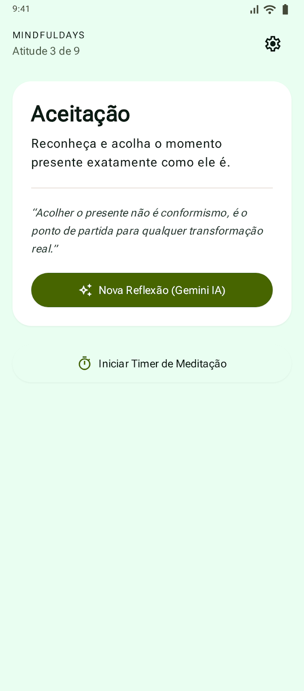
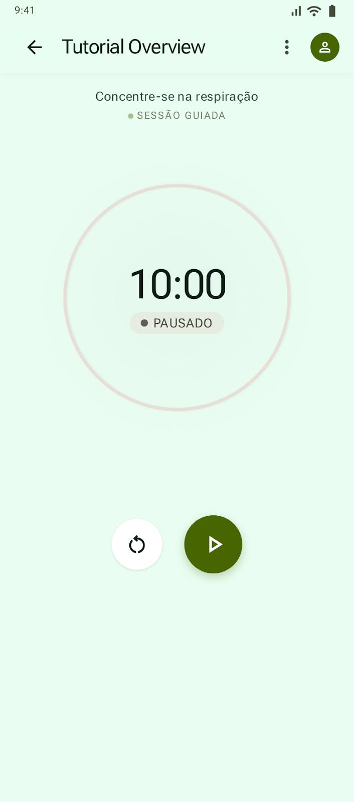
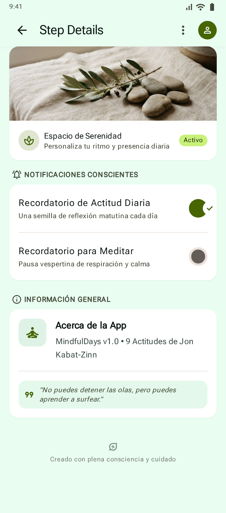
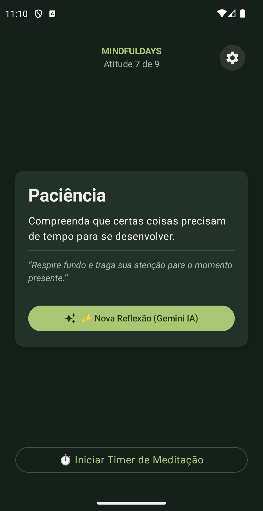
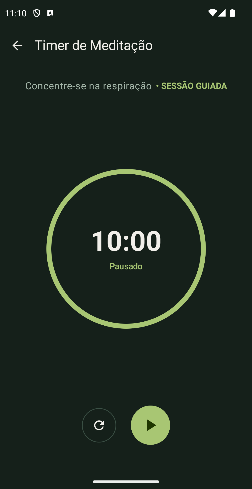
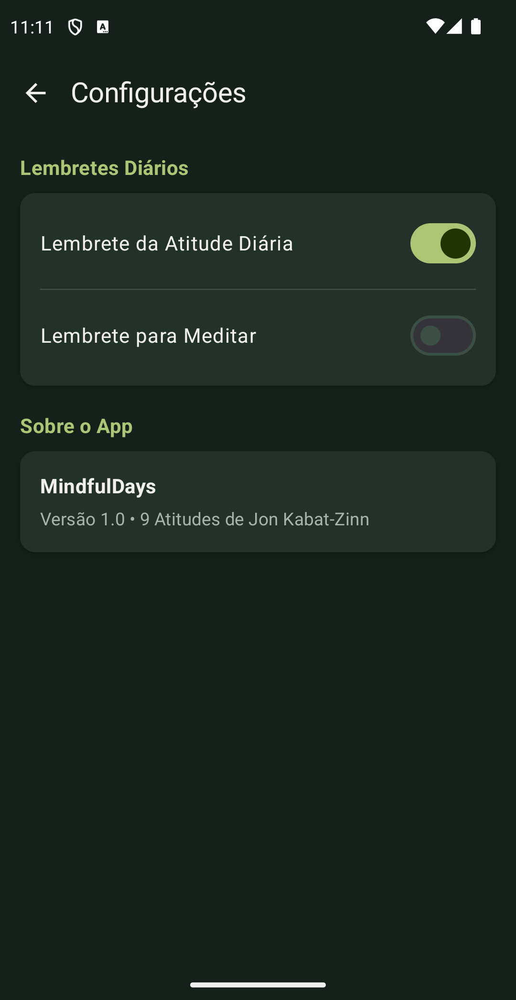

# 🎨 Módulo 1 — Prototipagem Visual e Design System no [Google Stitch](https://stitch.withgoogle.com/)

Neste módulo, vamos definir o fluxo de telas do app **MindfulDays** e utilizar o **[Google Stitch](https://stitch.withgoogle.com/)** para gerar a interface visual e extrair os *design tokens* em Material Design 3.

---

## 🗺️ 1.1. Estrutura das Telas (Sitemap)

O aplicativo possui um fluxo simples centrado em 3 telas:

1. **Home Screen**: Exibe a data atual, a indicação da atitude do dia (em ciclo de 1 a 9), card com frase reflexiva, botão de IA (*AI Sparkle*) para buscar um conselho via Gemini API e atalho para o timer.
2. **Timer Screen**: Contador regressivo circular e minimalista para meditação com controles de play, pause e reset.
3. **Settings Screen**: Opções de lembretes e notificações diárias com seletor de horário.

---

## 💬 1.2. Prompt de UI Prescritivo para o [Google Stitch](https://stitch.withgoogle.com/)

Para garantir que a IA gere um design limpo, didático e 100% alinhado com os componentes nativos do Android (evitando que o Stitch crie fontes customizadas ou telas sobrecarregadas com gráficos e players de áudio complexos), utilize este prompt prescritivo:

```text
Design an ultra-minimalist, clean Android mobile application interface for a tutorial app named "MindfulDays", strictly adhering to Material Design 3.

IMPORTANT DESIGN SYSTEM CONSTRAINTS (STRICT):
- Components: Use ONLY standard native Android Material 3 components (TopAppBar, ElevatedCard, Button, OutlinedButton, IconButton, Switch, OutlinedTextField, HorizontalDivider). DO NOT create custom complex components, custom pills, audio waveforms, habit streaks, or charts.
- Typography: Use standard Android system default typography (Roboto / system sans-serif). DO NOT use custom, serif, or imported fonts (no Newsreader, no Plus Jakarta Sans).
- Layout: Pure single-column layout with generous whitespace. Keep screens extremely simple and didactic for a live-coding workshop.
- Internationalization Readiness: All UI text elements, titles, and button labels must be concise and semantic, designed to map cleanly into Android string resources (English default, Portuguese, Spanish).
- Color Palette & Dual-Theme Support (Light & Dark Mode):
  * Light Mode:
    - Primary: Soft sage green (#6B8E23)
    - Primary Container / Accent: Soft sage (#8FA853)
    - Secondary / Dividers: Sand / Muted beige (#E8DFD8)
    - Background: Warm off-white (#FBF9F5)
    - Surface / Cards: Pure white (#FFFFFF)
    - Text / Icons: Dark forest green (#2C3E35)
    - Text Secondary: Muted forest green (#5C6F64)
  * Dark Mode:
    - Primary: Luminous sage green (#A8C673)
    - Primary Container: Deep forest elevated (#2E4239)
    - Secondary / Dividers: Subtle forest outline (#3B5045)
    - Background: Deep tranquil forest night (#15201A)
    - Surface / Cards: Elevated forest surface (#22322A)
    - Text / Icons: Warm off-white (#F1EFEA)
    - Text Secondary: Soft muted sage (#A3B5A8)
  * Semantic Consistency: Ensure all card containers, screen backgrounds, and texts use semantic Material 3 tokens so that switching themes provides excellent contrast without white-on-white text issues.

REQUIRED SCREENS & EXACT ELEMENTS:

1. Screen 1 — Home Screen:
   - Header (Top): App title "MINDFULDAYS" in small uppercase label + subtitle "Atitude 3 de 9" + a single Settings gear IconButton on the top-right corner.
   - Central ElevatedCard:
     * Attitude title in bold headline: "Aceitação"
     * Attitude description: "Reconheça e acolha o momento presente exatamente como ele é."
     * A thin horizontal divider
     * AI reflection text block: "Acolher o presente não é conformismo, é o ponto de partida para qualquer transformação real."
     * Primary filled Button with sparkle icon: "✨ Nova Reflexão (Gemini IA)"
   - Bottom Action: A single OutlinedButton spanning the width: "⏱️ Iniciar Timer de Meditação".
   (DO NOT include: profile avatar, greetings, photo banners, audio player, streak tracker, or bottom navigation bar).

2. Screen 2 — Meditation Timer Screen:
   - TopAppBar: Title "Timer de Meditação" with a back navigation arrow.
   - Center Area:
     * Subtitle text: "Concentre-se na respiração"
     * Single minimalist circular progress ring with large digital countdown text in center: "10:00" and a status text below: "Pausado".
   - Bottom Controls: Exactly two buttons in a centered horizontal row:
     * Reset OutlinedIconButton (circular refresh icon)
     * Play/Pause large FilledIconButton (circular primary button with Play icon)
   (DO NOT include: multiple dials, duration selector chips, interval bells, background sounds, or chime pickers).

3. Screen 3 — Settings Screen:
   - TopAppBar: Title "Configurações" with a back navigation arrow.
   - Reminders Card (Surface):
     * Row with text "Lembrete da Atitude Diária" and standard native Material 3 Switch (checked).
     * Thin horizontal divider.
     * Row with text "Lembrete para Meditar" and standard native Material 3 Switch (unchecked).
   - About Card (Surface):
     * Title: "Sobre o App"
     * Description text: "MindfulDays v1.0 • 9 Atitudes de Jon Kabat-Zinn"
   (DO NOT include: API key input fields, time wheel dialogs, sound selectors, nested accordion cards, or multi-tab navigation — API keys belong to code/configuration, never user UI).
```

---

## 📸 1.3. Capturas de Tela de Referência (Placeholders / Screenshots)

Se você estiver realizando o workshop ao vivo e não tiver acesso ao Stitch ou preferir ganhar tempo, pode utilizar diretamente estas capturas de tela pré-geradas disponíveis na pasta [`screenshots/`](../screenshots/):

### ☀️ Modo Claro (Light Mode — Referência Oficial Stitch)
| 01. Home Screen | 02. Timer Screen | 03. Settings Screen |
| :---: | :---: | :---: |
|  |  |  |
| `screenshots/home_screen.png` | `screenshots/timer_screen.png` | `screenshots/settings_screen.png` |

### 🌙 Modo Escuro (Dark Mode)
| 01. Dark Home | 02. Dark Timer | 03. Dark Settings |
| :---: | :---: | :---: |
|  |  |  |
| `screenshots/dark_home.png` | `screenshots/dark_timer.png` | `screenshots/dark_settings.png` |

> [!TIP]
> **Para o Módulo 2:** Salve ou tenha em mãos os arquivos `screenshots/home_screen.png`, `screenshots/timer_screen.png` e `screenshots/settings_screen.png` para anexá-los ao Gemini no Android Studio quando for utilizar a opção multimodal. Os tokens de design já estão incluídos diretamente no prompt do Módulo 2.

---

Pronto! Com a interface prototipada no [Google Stitch](https://stitch.withgoogle.com/), avance para o **`02-setup-android-studio-ai.md`**.
