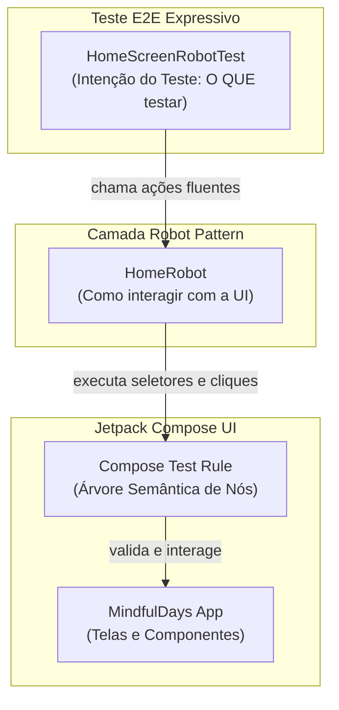

# 🧪 Módulo 4 — Qualidade de Software, Testes Automatizados com IA e Robot Pattern

Neste último módulo do workshop, vamos elevar a qualidade de engenharia do aplicativo **MindfulDays**. Em vez de focar apenas em configurações de infraestrutura de CI/CD, exploraremos na prática como a **Inteligência Artificial generativa** acelera a criação de suítes de testes robustas, cobrindo:
1. **Testes Unitários**: Validação da regra de negócio das 9 atitudes de Jon Kabat-Zinn e rotação temporal.
2. **Testes de UI em Jetpack Compose**: Validação de estados da interface declarativa e renderização de componentes.
3. **Testes End-to-End (E2E) com Robot Pattern**: Arquitetura limpa para testes visuais que separa *o que* está sendo testado de *como* a interface é manipulada, permitindo que a IA gere testes expressivos e sustentáveis.

---

## 🎯 4.1. Por que Testar com IA e o Papel do Robot Pattern?

Escrever testes de interface e de ponta a ponta (E2E) tradicionalmente exige muito esforço: seletores frágeis, repetição de código para encontrar elementos na árvore semântica e testes que quebram facilmente a cada pequena alteração de layout.

Com ferramentas de IA generativa (como o Gemini no Android Studio ou Claude):
- **A IA gera cenários de teste exaustivos e casos de borda** (ex: viradas de ano bissexto, textos longos, fallbacks de rede).
- **O Robot Pattern simplifica a geração pela IA**: ao definir uma classe "Robô" que encapsula os seletores da Compose Test Rule, pedimos à IA para gerar apenas a intenção de alto nível do teste (*"entre na Home, confira a reflexão e clique no timer"*), resultando em um código limpo, fluente e desacoplado.



---

## 🔬 4.2. Testes Unitários de Regra de Negócio (`AttitudeRepositoryTest`)

A regra de negócio central do **MindfulDays** define que a atitude do dia é calculada ciclicamente a partir do dia do ano:
$$\text{índice} = (\text{diaDoAno} - 1) \pmod 9$$

Vamos garantir a robustez dessa lógica criando o arquivo em `app/src/test/java/dev/mindfuldays/app/data/repository/AttitudeRepositoryTest.kt`:

```kotlin
package dev.mindfuldays.app.data.repository

import org.junit.Assert.assertEquals
import org.junit.Assert.assertNotNull
import org.junit.Assert.assertTrue
import org.junit.Before
import org.junit.Test

class AttitudeRepositoryTest {

    private lateinit var repository: AttitudeRepository

    @Before
    fun setUp() {
        repository = AttitudeRepository()
    }

    @Test
    fun `garantir que a lista possui exatamente 9 atitudes de mindfulness`() {
        val attitudes = repository.attitudes
        assertEquals(9, attitudes.size)
    }

    @Test
    fun `garantir que todas as atitudes possuem IDs unicos e recursos de string validos`() {
        val attitudes = repository.attitudes
        val ids = attitudes.map { it.id }.toSet()
        assertEquals(9, ids.size)

        attitudes.forEach { attitude ->
            assertTrue("ID de recurso do nome não deve ser zero", attitude.nameRes != 0)
            assertTrue("ID de recurso da descrição não deve ser zero", attitude.descriptionRes != 0)
            assertTrue("Nome padrão não deve ser vazio", attitude.name.isNotBlank())
        }
    }

    @Test
    fun `garantir rotacao ciclica correta das 9 atitudes pelo dia do ano`() {
        // Dia 1 (1 de Janeiro): Primeira atitude (id = 1)
        assertEquals(1, repository.getTodayAttitude(dayOfYear = 1).id)

        // Dia 9: Nona atitude (id = 9)
        assertEquals(9, repository.getTodayAttitude(dayOfYear = 9).id)

        // Dia 10: Reinicia o ciclo na primeira atitude (id = 1)
        assertEquals(1, repository.getTodayAttitude(dayOfYear = 10).id)

        // Dia 365 (ano comum): (365 - 1) % 9 = 364 % 9 = 4 -> índice 4 -> id = 5 ("Confiança")
        assertEquals(5, repository.getTodayAttitude(dayOfYear = 365).id)
    }

    @Test
    fun `garantir que a chamada padrao de hoje retorna uma atitude valida`() {
        val today = repository.getTodayAttitude()
        assertNotNull(today)
        assertTrue(today.id in 1..9)
    }
}
```

### 🤖 Prompt para o Gemini gerar Testes Unitários
No Android Studio, você pode abrir o arquivo `AttitudeRepository.kt` e enviar o seguinte prompt ao assistente:

```text
Atue como um Engenheiro de QA Android sênior.
Analise a classe AttitudeRepository.kt fornecida.
Escreva uma suíte completa de testes unitários com JUnit 4 testando:
1. Se a lista contém exatamente 9 itens únicos.
2. A regra de rotação temporal cíclica baseada no dia do ano (teste o primeiro dia, o 9º dia, o reinício no 10º dia e o último dia do ano).
3. Se todos os atributos obrigatórios e referências a recursos de strings (@StringRes) estão preenchidos.
Gere código Kotlin idiomático com nomes de métodos descritivos em crases.
```

### ⚡ Executando os Testes Unitários
No terminal do Android Studio, execute:
```bash
./gradlew testDebugUnitTest
```
> O relatório visual em HTML com o resultado dos testes fica disponível em `app/build/reports/tests/testDebugUnitTest/index.html`.

---

## 📱 4.3. Testes de Interface com Jetpack Compose

Com o Jetpack Compose, não usamos IDs de views XML. O Compose utiliza uma **Árvore Semântica** (*Semantics Tree*) para encontrar nós de texto, descrições de acessibilidade e estados dos componentes.

Podemos testar o composable desacoplado `HomeScreenContent` verificando a renderização dos dados e se as lambdas de evento disparam corretamente ao clicar nos botões.

---

## 🤖 4.4. Testes End-to-End com o Robot Pattern

O **Robot Pattern** é um padrão consagrado no ecossistema Android que consiste em:
1. Criar uma classe **Robot** responsável por isolar todos os comandos da `ComposeContentTestRule` (encontrar nós por texto, clicar em botões, checar visibilidade).
2. Fornecer uma **DSL fluente** (`homeRobot { ... }`) onde o teste lê como uma sequência de ações do usuário em linguagem natural.

### 1. Criando o `HomeRobot.kt`
Crie o arquivo em `app/src/androidTest/java/dev/mindfuldays/app/robot/HomeRobot.kt`:

```kotlin
package dev.mindfuldays.app.robot

import androidx.compose.ui.test.assertIsDisplayed
import androidx.compose.ui.test.junit4.ComposeContentTestRule
import androidx.compose.ui.test.onNodeWithContentDescription
import androidx.compose.ui.test.onNodeWithText
import androidx.compose.ui.test.performClick

/**
 * Robot Pattern para a HomeScreen.
 * Encapsula as interações e asserções da interface do usuário em Jetpack Compose,
 * tornando os testes declarativos, legíveis e fáceis de manter.
 */
class HomeRobot(private val composeTestRule: ComposeContentTestRule) {

    fun assertTitleDisplayed(title: String) = apply {
        composeTestRule.onNodeWithText(title).assertIsDisplayed()
    }

    fun assertAttitudeName(name: String) = apply {
        composeTestRule.onNodeWithText(name).assertIsDisplayed()
    }

    fun assertReflectionText(reflection: String) = apply {
        composeTestRule.onNodeWithText(reflection).assertIsDisplayed()
    }

    fun clickGenerateReflection(buttonText: String) = apply {
        composeTestRule.onNodeWithText(buttonText).performClick()
    }

    fun clickSettingsButton(contentDescription: String) = apply {
        composeTestRule.onNodeWithContentDescription(contentDescription).performClick()
    }

    fun clickTimerButton(buttonText: String) = apply {
        composeTestRule.onNodeWithText(buttonText).performClick()
    }
}

/**
 * Função DSL para inicializar e executar passos com o HomeRobot.
 */
fun homeRobot(
    composeTestRule: ComposeContentTestRule,
    block: HomeRobot.() -> Unit
): HomeRobot = HomeRobot(composeTestRule).apply(block)
```

---

### 2. Criando o Teste E2E Expressivo (`HomeScreenRobotTest.kt`)
Crie o arquivo em `app/src/androidTest/java/dev/mindfuldays/app/HomeScreenRobotTest.kt`:

```kotlin
package dev.mindfuldays.app

import androidx.compose.ui.test.junit4.createComposeRule
import androidx.test.ext.junit.runners.AndroidJUnit4
import dev.mindfuldays.app.data.model.MindfulnessAttitude
import dev.mindfuldays.app.robot.homeRobot
import dev.mindfuldays.app.ui.home.HomeScreenContent
import dev.mindfuldays.app.ui.theme.MindfulDaysTheme
import org.junit.Assert.assertTrue
import org.junit.Rule
import org.junit.Test
import org.junit.runner.RunWith

@RunWith(AndroidJUnit4::class)
class HomeScreenRobotTest {

    @get:Rule
    val composeTestRule = createComposeRule()

    @Test
    fun homeScreen_exibeAttitudeEReflexao_eDisparaAcoes() {
        var clickedAi = false
        var clickedTimer = false
        val attitude = MindfulnessAttitude(
            id = 3,
            name = "Aceitação",
            description = "Reconheça e acolha o momento presente exatamente como ele é.",
            nameRes = R.string.attitude_3_name,
            descriptionRes = R.string.attitude_3_desc
        )

        composeTestRule.setContent {
            MindfulDaysTheme {
                HomeScreenContent(
                    attitude = attitude,
                    aiReflection = "Reflexão de teste para o workshop",
                    isLoadingAi = false,
                    onGenerateAiReflection = { clickedAi = true },
                    onNavigateToSettings = {},
                    onNavigateToTimer = { clickedTimer = true }
                )
            }
        }

        // Obtém o contexto para buscar strings internacionalizadas
        val context = androidx.test.platform.app.InstrumentationRegistry.getInstrumentation().targetContext

        // Execução expressiva e limpa com o Robot Pattern
        homeRobot(composeTestRule) {
            assertReflectionText("Reflexão de teste para o workshop")
            clickGenerateReflection(context.getString(R.string.btn_new_reflection))
            clickTimerButton(context.getString(R.string.btn_start_timer))
        }

        // Valida que as ações foram disparadas
        assertTrue("O botão de IA deve ter sido acionado", clickedAi)
        assertTrue("O botão de navegação para o Timer deve ter sido acionado", clickedTimer)
    }
}
```

> [!TIP]
> **Compatibilidade com Internacionalização (i18n) em Testes:**
> Ao utilizar `context.getString(R.string.btn_new_reflection)` para buscar os botões e textos, o teste é automaticamente compatível com qualquer idioma ativo no emulador (seja Português, Inglês ou Espanhol), sem quebras por textos hardcoded!

---

### 🤖 4.5. Prompt para Pedir à IA a Criação de Novos Robots
Ao demonstrar isso no workshop, mostre aos participantes como pedir para a IA criar novos Robots para outras telas (como a `TimerScreen` ou `SettingsScreen`):

```text
Você é um especialista em testes de UI Android com Jetpack Compose.
Analise a tela Composable em anexo (TimerScreen.kt).
1. Crie uma classe 'TimerRobot' utilizando o Robot Pattern com ComposeContentTestRule, contendo:
   - Métodos de asserção: assertTimerTextIsDisplayed(time: String), assertStatusIsDisplayed(status: String).
   - Métodos de ação: clickPlayPause(), clickReset().
   - Uma função DSL 'timerRobot(rule) { ... }' que retorne o Robot.
2. Em seguida, escreva um teste instrumentado com JUnit 4 usando o TimerRobot simulando:
   - Iniciar com o timer pausado em "10:00".
   - Clicar no botão Play/Pause e verificar a transição.
   - Clicar em Reset e verificar o retorno a 10:00.
Utilize o padrão fluente (chaining) com 'apply'.
```

---

### ⚡ Executando os Testes Instrumentados no Emulador
Com o emulador iniciado, execute no terminal:
```bash
./gradlew connectedDebugAndroidTest
```
O Gradle irá compilar o APK de teste, instalar no emulador, executar as interações visuais e reportar o resultado com sucesso!

---

## 🚀 4.6. Checklist de Validação Final do Workshop

Para encerrar o workshop com sucesso, faça a verificação completa do projeto executando os comandos prescritos no seu `AGENTS.md`:

```bash
# 1. Executa todos os testes unitários
./gradlew testDebugUnitTest

# 2. Executa a análise estática e lint
./gradlew lintDebug

# 3. Compila o APK final de debug
./gradlew assembleDebug
```

---

🎉 **Parabéns!** Você concluiu todos os módulos do workshop **MindfulDays**!
Você aprendeu na prática a prototipar telas com **Google Stitch**, estruturar diretrizes com **AGENTS.md**, integrar a **Gemini API** com **Retrofit/Moshi**, internacionalizar a aplicação em **PT, EN e ES** e garantir a qualidade do software com **Testes Unitários e Robot Pattern acelerados por IA**!
